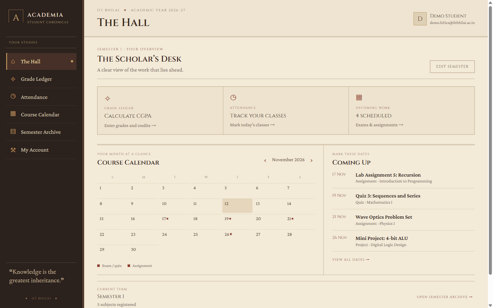

# Acad-Tracker

A full-stack academic tracker for IIT Bhilai students. Track attendance, deadlines, timetable and GPA for a whole semester in one place.

- **GitHub:** https://github.com/kansalakshat/Acad-Tracker
- **Live API:** https://acad-tracker-api.vercel.app/api/health
- **Live website:** https://acad-tracker-0s.vercel.app



More screenshots in [`docs/screenshots`](docs/screenshots).

## Team

| Roll No. | Name | GitHub |
|----------|------|--------|
| B25CS003 | Soham | [Sohamnotavailable](https://github.com/Sohamnotavailable) |
| B25CS005 | Akshat | [kansalakshat](https://github.com/kansalakshat) |
| B25CS016 | Divyansh | [Divvyansh02](https://github.com/Divvyansh02) |
| B25CS017 | Farukh | [Farukh075](https://github.com/Farukh075) |

## Features

- Sign up and log in with an `@iitbhilai.ac.in` email (checked on both frontend and backend).
- First-login onboarding: semester, subjects, credits and weekly timetable.
- Dashboard with academic summary, calendar and upcoming deadlines.
- Attendance: mark Present, Absent or Cancelled, add extra classes, see percentage per subject.
- Planner for exams, quizzes, projects and assignments.
- GPA calculator (credit-weighted, failed grades excluded).
- Reminders before deadlines by email and browser push (separate worker).
- Account page to edit semester and subjects.
- Custom medieval "archive" theme: parchment, brick red and gold, Cinzel and Crimson Pro fonts.

## Tech stack

| Part | Technology |
|------|------------|
| Frontend | React, Vite, CSS Modules |
| Backend | Node.js, Express |
| Database | MySQL 8 |
| Auth | JWT, bcrypt |
| Reminders | node-cron, Nodemailer, web-push |
| Hosting | Vercel (frontend + API), Aiven (MySQL) |

## Project structure

```
Acad-Tracker/
├── frontend/            React app (Vite)
│   └── src/
│       ├── features/    one folder per page (auth, dashboard, attendance, ...)
│       ├── components/  shared UI (Shell, Sidebar, Button, ...)
│       └── api.js       fetch wrapper that talks to the backend
└── backend/             Express REST API
    ├── routes/ controllers/ models/ middleware/
    ├── schema.sql       database tables
    ├── smoke-test.js    checks every API endpoint
    └── src/             reminder worker (email + push)
```

## How to run on your computer

### 1. Install

- [Node.js 18 or newer](https://nodejs.org)
- [MySQL 8](https://dev.mysql.com/downloads/mysql/) (or XAMPP / WAMP MySQL)

### 2. Create the database

Open a MySQL shell and run:

```sql
CREATE DATABASE academic_helper;
USE academic_helper;
SOURCE path/to/Acad-Tracker/backend/schema.sql;
```

### 3. Start the backend (API)

```bash
cd backend
npm install
cp .env.example .env      # Windows: copy .env.example .env
```

Open `backend/.env` and set:

- `DB_USER`, `DB_PASSWORD` to your MySQL login
- `JWT_SECRET` to any long random string
- Leave `CLIENT_ORIGIN=http://localhost:5173`

Then:

```bash
npm run dev
```

Check it works: open http://localhost:4000/api/health. You should see `"status":"ok"`.

### 4. Start the frontend

Open a **second** terminal:

```bash
cd frontend
npm install
cp .env.example .env      # Windows: copy .env.example .env
npm run dev
```

Open http://localhost:5173. Sign up with any `name@iitbhilai.ac.in` email.

### 5. (Optional) Reminder worker

Sends email and browser reminders before deadlines. Needs SMTP and VAPID keys in `backend/.env`.

```bash
cd backend
npx web-push generate-vapid-keys   # paste keys into .env
npm run worker
```

Keep `DRY_RUN=true` to log reminders instead of sending them.

### 6. (Optional) Test the API

With the backend running:

```bash
cd backend
node smoke-test.js
```

## API overview

| Route | Purpose |
|-------|---------|
| `POST /api/auth/register`, `POST /api/auth/login` | Create account, log in (returns JWT) |
| `GET/PATCH /api/auth/me` | Current user |
| `/api/courses` | Subjects and credits (CRUD) |
| `/api/timetable` | Weekly class slots |
| `/api/attendance` | Mark, update and summarise attendance |
| `/api/assignments` | Deadlines (CRUD, mark complete) |
| `/api/notifications` | Reminder settings, push subscription |

All routes except register, login and health need the header `Authorization: Bearer <token>`.

## Security

- Passwords hashed with bcrypt; JWT on every protected route.
- Every query is scoped to the logged-in user.
- Parameterised SQL queries only.
- Rate limiting on login and signup.
- CORS allowlist; secrets only in `.env` (git-ignored).

## Submission files

- `Acad-Tracker_Presentation.pptx`: presentation
- `Acad-Tracker_Report.docx`: project report
